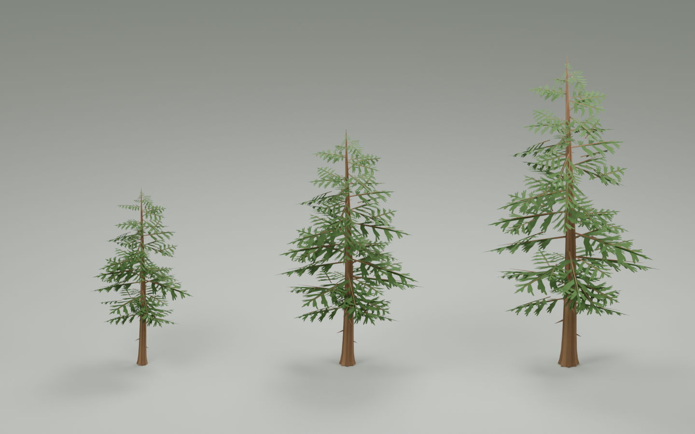

# 程序化森林资产（Procedural Forest Assets）

基于Blender的程序化树木与资产处理项目。这个仓库提供三棵可编辑的Geometry Nodes树木、资产检查与FBX导出工具，以及可对照的示例结果。

*上图由本仓库的Blender源文件实际渲染。三种树型共用节点组，通过各自的参数控制外形；这是Blender预览，不是UE运行截图。*

## 项目内容

- **参数化树木**：复用树干、枝条与叶簇母版，通过树高、冠宽等参数调整树型，保留可编辑节点图和WindMask颜色属性。
- **资产检查**：读取求值后的网格、尺寸、UV层、材质槽和颜色属性，将检查结果记录为JSON。
- **批量导出**：将Geometry Nodes结果转换为临时网格，逐件输出FBX和报告，处理同名文件、导出失败与临时数据清理。

## 我的工作

我的实践包括树木参数调整、检查和导出工具的使用，以及输出结果的核对。部分参考结构、美术布局和Python工具使用AI辅助生成与整理，详见[CREDITS.md](CREDITS.md)。

## 文件入口

| 文件 | 用途 |
| --- | --- |
| [blender/forest_trees.blend](blender/forest_trees.blend) | 三棵树、生成所用母版、节点组及预览场景 |
| [scripts/inspect_selected_assets.py](scripts/inspect_selected_assets.py) | 检查当前选中网格，将结果写入Blender文本数据块 |
| [tools/fsl_batch_exporter](tools/fsl_batch_exporter/) | 支持Geometry Nodes求值结果的批量检查与导出插件源码 |
| [tools/fsl_batch_exporter.zip](tools/fsl_batch_exporter.zip) | 可直接安装的插件包 |
| [scripts/export_single_mesh.py](scripts/export_single_mesh.py) | 早期单网格导出脚本，仅接受无修改器、无实例的普通网格 |
| [examples](examples/) | 三个FBX与经过路径整理的导出、验证报告 |

## 打开与使用

验证环境：**Blender 5.2.2 LTS**。其他版本尚未测试。

1. 下载仓库，在Blender中打开`blender/forest_trees.blend`。
2. 选中`SM_GN_Pine_A`、`SM_GN_Pine_B`或`SM_GN_Pine_C`，在Geometry Nodes修改器中调整参数。建议另存副本进行试验。
3. 需要导出时，安装`tools/fsl_batch_exporter.zip`并启用插件。在三维视图的`N → FSL`面板选择“所选对象”，指定新的输出目录，先检查，再批量导出。
4. 导出结果可与`examples/`中的尺寸、面数、材质槽和颜色属性对照。同名输出不会被覆盖；测试新版本时请使用新的输出目录。

`inspect_selected_assets.py`用于直接网格检查，不会完整展开所有实例；检查提醒需要结合资产用途判断。当前GN树木应使用批量插件导出，不能直接运行早期单网格脚本。

## 验证范围

发布时核对源文件重开、树木几何数据与FBX回读，并保留报告。导出副本与用户工程的节点参数、局部几何保持一致，整理了重复展示对象、相机与灯光。

检查和导出成功不等于所有用途均已验收：UV展开质量、目标UE工程中的材质与风动、碰撞、关节和机器人仿真仍需各自验证。具体结果见[examples/validation.json](examples/validation.json)。

## English overview

Procedural Forest Assets is a personal technical-art project focused on procedural trees and Blender asset processing. The repository contains editable Geometry Nodes assets, Python inspection scripts, an AI-assisted batch FBX exporter, and verified sample outputs. My practice focuses on tree parameters, tool usage, and checking results. The image above is rendered from the included Blender scene. This release packages Blender assets and tools; it does not include the complete Unreal Engine scene or a robotics simulation setup. See CREDITS for reference and tool provenance.
